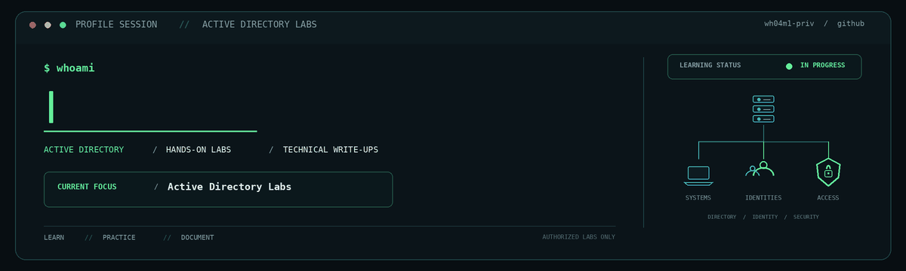

  

  <h2>Cybersecurity · Active Directory · Hands-on Labs</h2>
  
<em>Learn by solving labs, exploring new concepts, and documenting what I discover.</em>

  

    
    
    
  

---

## `01` / About Me

Hi, I'm **Muhammad Ibrahim**. I'm interested in cybersecurity, with a particular interest in **Active Directory** and how it works in real environments.

I've covered the fundamentals and am currently spending my time solving **Active Directory labs**, strengthening what I know, and learning new concepts as I encounter them. I enjoy working through a problem, understanding why something works, and keeping notes along the way.

I also share write-ups for the labs I complete. They document my approach, the steps I took, useful commands, findings, and the main things I learned. I aim to make them clear enough that someone else working through a similar lab can follow the process.

## `02` / What I'm Focusing On

- **Active Directory labs** — practicing in lab environments and learning how different AD components fit together.
- **New security concepts** — researching unfamiliar topics and building an understanding through hands-on practice.
- **Lab documentation** — writing up completed exercises, including the methodology, observations, and takeaways.

## `03` / Lab Write-ups

I use this space to keep a record of the labs I work through. Each write-up focuses on the specific environment and documents the techniques and commands used in that lab, rather than presenting them as skills I have mastered.

More write-ups will be added as I complete more labs.

---

  <b>whO$M1-Priv</b> · Keep learning. Keep practicing. Document the process.
   
  <a href="https://github.com/wh04m1-priv">github.com/wh04m1-priv</a>

